# gurk 🥒 — extended version

This repository extends [gurk](https://github.com/boxdot/gurk-rs), the terminal
[Signal Messenger](https://signal.org) client by **boxdot and contributors**.
The original project remains the foundation of this version.

**Development provenance.** Extension code starting with commit
`76a614d244afab1d1e2524b5f56b15584968b60b` was generated by **OpenAI Codex** under
**bitounu's curation**. bitounu does not know the Rust language: their role was
limited to requesting features and usability improvements, and testing the
results. This extension work began on **2026-11-05**. Original gurk and vendored
library code retain their respective authorship and licenses.

## Contents

- [About this version](#about-this-version)
- [Install and build](#install-and-build)
- [Get started](#get-started)
- [Features](#features)
  - [Local aliases](#local-aliases)
  - [Drafts](#drafts)
  - [Attachments and screenshots](#attachments-and-screenshots)
  - [Image previews](#image-previews)
  - [Attachment gallery](#attachment-gallery)
  - [Favorite conversations](#favorite-conversations)
  - [Hidden conversations](#hidden-conversations)
  - [Message order](#message-order)
  - [Search and text selection](#search-and-text-selection)
  - [Editing sent messages](#editing-sent-messages)
  - [Contact mentions](#contact-mentions)
  - [ASCII emoticons](#ascii-emoticons)
  - [Offline spelling](#offline-spelling)
  - [Image metadata cleaning](#image-metadata-cleaning)
  - [Forwarding](#forwarding)
  - [Private read synchronization](#private-read-synchronization)
- [Keyboard shortcuts](#keyboard-shortcuts)
- [Configuration](#configuration)
- [Secure Backup restore](#secure-backup-restore)
- [Troubleshooting and limits](#troubleshooting-and-limits)
- [Credits, license and contact](#credits-license-and-contact)

## About this version

Gurk links to an existing Signal account and provides conversations, groups,
replies, reactions and attachments in a terminal. This version adds local
aliases, persistent drafts, file selection, image galleries, search, offline
spelling, image metadata cleaning, native mentions and experimental backup import.

Existing configuration files remain readable. Database migrations run
on startup. Some visible additions are opt-in: inline image previews, the shortcut
bar and ASCII emoticon replacement are disabled by default. See
[configuration defaults](#defaults).

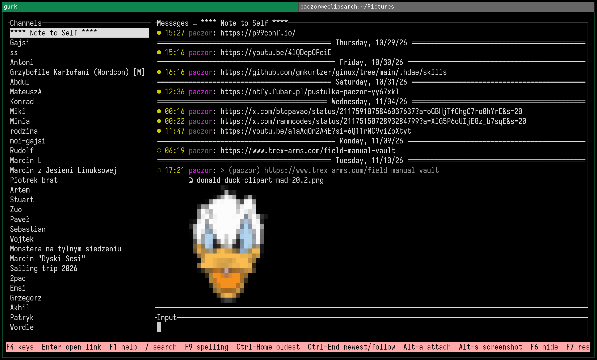

*Conversation layout and inline image preview.*

## Install and build

### Build this extended version

Use a checkout of **this repository**. From its root:

```sh
cargo build --release --locked
./target/release/gurk
```

To install the executable into Cargo's binary directory instead:

```sh
cargo install --path . --locked
```

Build requirements include Rust **1.94 or newer**, Git, `protoc`, a C/C++ build
toolchain, Clang/libclang, CMake, Perl and pkg-config. See
[Cargo.toml](Cargo.toml) and the [Arch recipe](packaging/arch/PKGBUILD) for the
pinned dependencies and build requirements. Several Signal libraries are Git
dependencies, so this application cannot be installed as a crates.io release.

### Arch Linux package

On Arch, run as a regular user with `base-devel` installed:

```sh
cd packaging/arch
makepkg -si
```

The package is named `gurk-local-aliases`, installs `/usr/bin/gurk`, and replaces
conflicting `gurk`, `gurk-git` or `gurk-bin` packages through pacman. It does not
ship or overwrite your configuration, account registration or message database.
See [Arch installation notes](packaging/arch/README.md).

### Upstream packages

[Upstream releases](https://github.com/boxdot/gurk-rs/releases), upstream
`cargo-binstall`/Git installs, Arch's `gurk` package, Nix's `gurk-rs` and FreeBSD's
`net-im/gurk-rs` install the **original gurk**, without this repository's added
features. Use the build instructions above for the extended version.

## Get started

Run `gurk`. On a new installation, it opens a QR code in an image viewer so you
can link it as another device in Signal. It also creates a configuration file.
An existing installation using the same data directory keeps its linked account.

Before the first start with an existing database, close other gurk instances and
copy its data directory. Newer schemas cannot necessarily be opened by older
builds; reverting can require restoring that copy as well as the old executable.

Use Up/Down to choose a conversation and Enter to send text. PgUp/PgDown select
messages for replies and other actions. PgDown past the newest selected message
clears reply selection and resumes following the conversation. F1 opens bounded,
scrollable help; F4 toggles the contextual shortcut bar.

## Features

### Local aliases

**F2** edits the current conversation's alias. **F3** edits the selected message
author's alias, or the direct conversation's contact when no message is selected.
In a group, select a message to choose a person. Enter saves, Esc cancels, and
saving an empty value restores the original name.

Aliases are stored locally and never rename a Signal contact or group. They
survive restarts and apply to names in messages, quotes, mentions and
notifications. Conversation aliases take precedence in conversation lists;
person aliases remain full-length even with `first_name_only = true`. Removing
an alias reveals the current synchronized name. Editing preserves the draft.

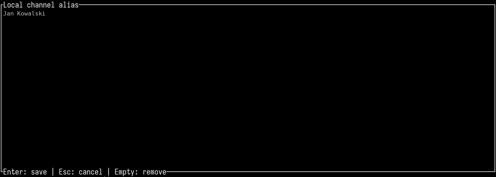

*Local alias editor. Enter saves; Esc cancels.*

### Drafts

Text, cursor position, staged file paths, editing context and the active
conversation are saved per conversation automatically and on clean exit. They
return in the correct conversation after restart. Staged attachments refer to
the original files: keep those files available until sending.

Esc first dismisses a composer error while keeping the draft and files. A
subsequent Esc performs the normal cancellation or selection action.

### Attachments and screenshots

**Alt+A** opens the file picker in your home directory. It shows names,
modification dates and human-readable sizes. **Space** marks up to **10 files**
across directories; the header shows the count. Enter on a directory enters it;
Enter on a file stages the marked files, or that file when none are marked.

In the picker, Left/Backspace opens the parent directory and Right enters the
highlighted directory. `.` toggles dotfiles; `t` switches name/time sorting, with
directories first. `~` opens home, `p` opens `~/Pictures`, `s` opens the screenshot
directory, and `/` accepts a typed or pasted path. Alt+P previews the highlighted
file independently of selection; Alt+O opens it through its desktop MIME
association. See [MIME associations](#mime-associations).

Files are staged before sending. **Enter in the conversation sends** them with
the caption; Esc removes staged files while preserving text. Images have a
pending preview and other files have type labels/icons. The total pending limit
is **10 files and 100 MiB**. `file:///path/to/file` and `file://clip` also attach
a file or clipboard image.

**Alt+S** captures a screenshot and stages it in the conversation where capture
began. Enter is still required to send. Screenshots remain saved if sending is
cancelled. The default directory is `~/Pictures` when it exists, otherwise home;
`screenshot_dir` overrides it. On Linux, capture tries the desktop portal, then
`grim` on Wayland or `maim -s`/`scrot -s` on X11. A configured
`screenshot_command` bypasses this selection and receives the output path as a
separate argument, without a shell.

Mixed files may become **several Signal messages**. Contiguous JPEG/PNG/WebP
images stay in an album; generic files, HEIC, GIF, audio and video are sent
separately. Caption and reply quote appear in the first part only. Parts retain
their order and have unique timestamps; delivery is not atomic across parts.
Preparation/upload failures are reported. A local preview alone is not proof
that a recipient received the file.

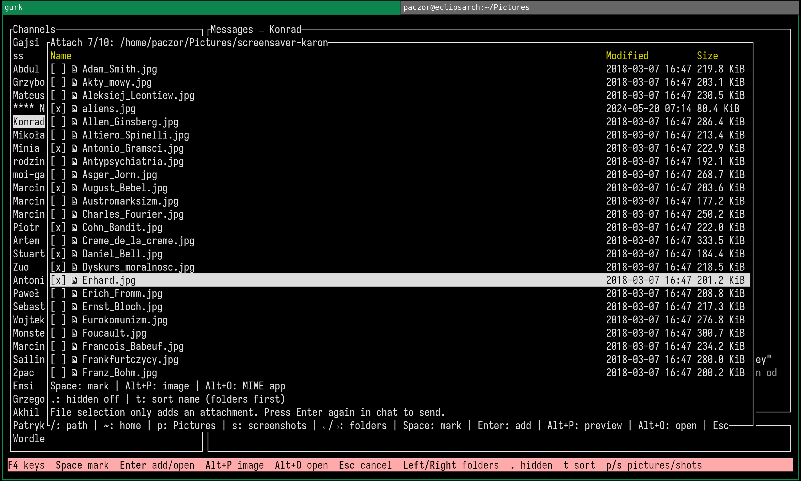

*File picker with 7 files marked out of a maximum of 10, modification dates and human-readable sizes.*

### Image previews

Enable `show_image_previews = true` for inline thumbnails fitted to the
conversation pane. They preserve proportions and adjust when the terminal is
resized. Colored Unicode half blocks work without a graphics protocol; true
color gives the best result. Transparent pixels are composited onto black.

PNG, JPEG, GIF's first frame, WebP, BMP and TIFF are detected from contents.
Decoding runs in bounded background workers with a thumbnail cache. Limits are
32 MiB per file and roughly 16 megapixels; up to 32 visible attachment files are
considered for previews at once. Unsupported, missing or oversized files remain
accessible through their attachment labels. Labels show filenames by default;
`show_attachment_paths = true` reveals full file URLs.

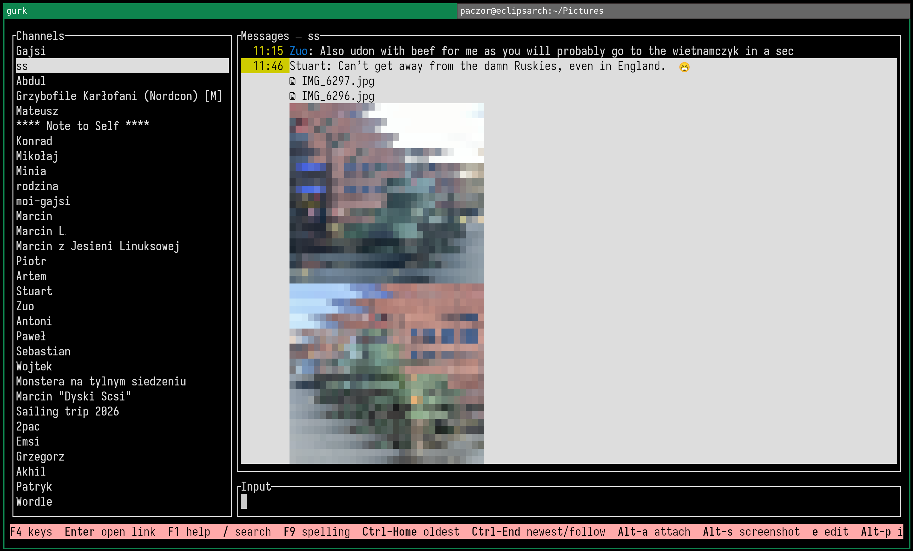

*A selected message contains two image attachments. Alt+P opens the attachment gallery.*

### Attachment gallery

Select a message and press **Alt+P**, even if inline previews are disabled.
Left/Right selects another attachment, **+/-** zooms, and **Alt+arrows** pans a
zoomed image to its edges. The title shows the current index, filename and zoom.
Changing attachments resets zoom; changing zoom recenters the image. Esc, q or
the viewer shortcut returns to the conversation or picker with the draft intact.

The internal viewer negotiates Kitty, Sixel or iTerm2 graphics and falls back to
Unicode half blocks. `protocol = "halfblocks"` avoids graphics queries. Fullscreen
viewing uses the same image/decode limits as inline previews. Images and rendered
frames stay in RAM and are released on close; zooming creates no disk files.
The picker always uses the internal gallery, regardless of message-viewer mode.

An external graphical viewer, such as sxiv, can be selected in
`[image_viewer]`. Gurk appends the original image path as one argument without a
shell; the program's terminal input/output is disconnected. A failed launch or
unsuccessful exit falls back to internal viewing. Esc does not kill an already
opened external window. Interactive terminal commands such as `icat` are not
external GUI viewers; use internal graphics-protocol rendering instead.

Nonimages or files whose image type is unrecognized open through **`$EDITOR`**.
Use a command that waits, such as `nvim` or `code --wait`. Gurk temporarily hands
over the terminal, then restores it. The editor receives a private, read-only
copy, up to 100 MiB; the original is unchanged. Copies and editor sidecars are
removed after exit. Missing files and recognized but invalid images show a
closable error rather than opening an editor.

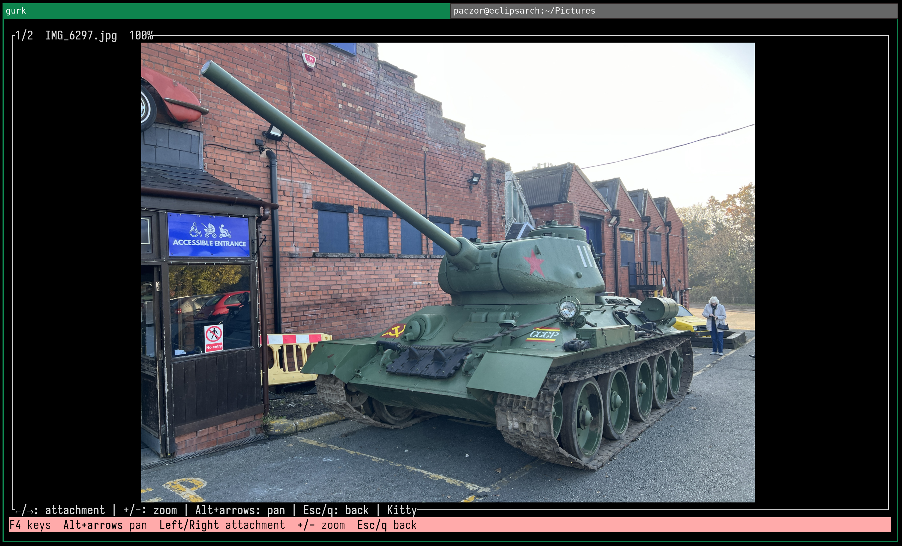

*First attachment, shown at 100% in the Kitty renderer.*

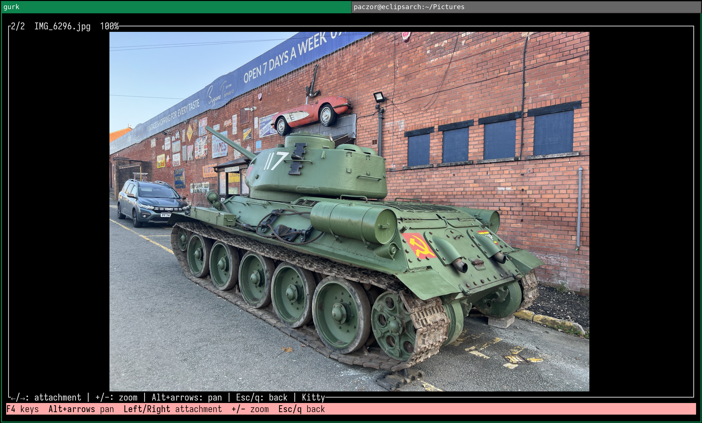

*Right switches to the second attachment; Left returns to the first.*

<details>
<summary>Zoom and panning examples</summary>

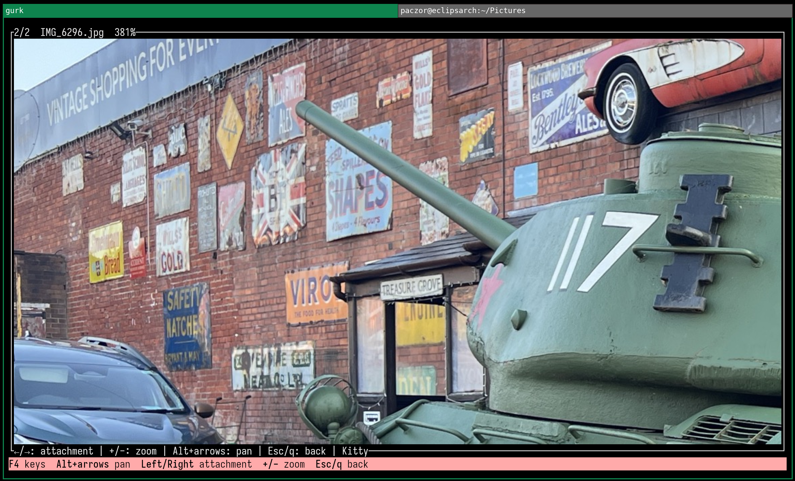

*Second attachment at 381%, panned toward the upper left with Alt+arrows.*

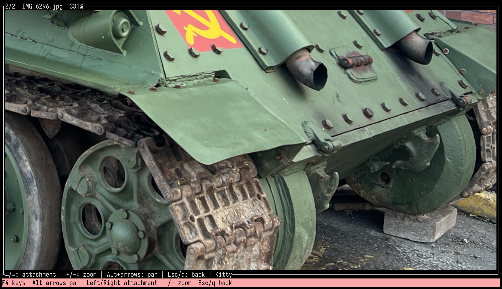

*The same attachment and zoom, panned toward the lower right. +/- changes zoom; Esc returns to the conversation.*

</details>

### Favorite conversations

**F5** toggles the active contact or group as a local favorite. Favorites stay
at the top of the conversation pane. A horizontal line
separates them from other conversations when both sections are present. Each
section keeps its usual most-recent-activity order; new messages in other
conversations do not displace favorites. The separator cannot be selected.

Favorites survive restarts and alias/name changes. Hiding a favorite still hides
and silences it; restoring it returns it to the favorites section. Toggling does
not change the active conversation, draft or message selection. Existing databases
start with no favorites. Rebind `toggle_favorite` under `[keybindings.normal]`
in `gurk.toml` if needed; this setting is local and is not sent to Signal.

### Hidden conversations

**F6** hides and silences the current conversation locally. It disappears from
the conversation list and Ctrl+P picker; new messages are still stored and do not
make it reappear. Hiding a person also silences their messages/reactions in other
groups. This is a visibility setting, not Signal blocking.

**F7** lists hidden conversations using current names/aliases. Up/Down selects,
Enter restores and Esc closes. History and drafts remain available. Restoring
removes the hidden mute; a separately configured channel mute stays in force.

### Message order

`message_order = "sent"` is the default sender-timestamp order.
`message_order = "received"` uses a stable sequence assigned when this device
first stores or creates a message, avoiding reshuffling caused by sender-clock
skew. Visible clock times and Signal identifiers remain unchanged.

Existing history is initially seeded in its previous order: an old reception
order that was never recorded cannot be reconstructed. New receipt order is
recorded in either mode. Late synchronization/import can still differ from
another device. Restart after changing the setting.

### Search and text selection

Press **/** with an empty composer, or **F8** with any draft, to search the active
conversation's full message text. Search is literal and Unicode case insensitive;
each occurrence is a separate result. It excludes other conversations and
attachment names/metadata, and sends no query to Signal. `/` inside a draft stays
literal.

Up/Down or Shift+F3/F3 navigates occurrences. Enter keeps the current position and
highlight; Esc restores the pre-search position. Drafts and staged files remain.
Ctrl+Home jumps to the oldest message; Ctrl+End jumps to the newest and follows
new messages. The result remains selected for replies; Esc or PgDown past the
newest message clears selection. A long message shows the matching fragment.

**Alt+V** opens a frozen text snapshot of the loaded conversation fragment.
Arrows move, Space starts/clears selection, and Enter copies to the system
clipboard and closes. Home/End and PgUp/PgDown navigate; Esc or Alt+V cancels.
Selection respects graphemes and retains original newlines, without UI names,
timestamps or image previews. To copy older history, navigate there first and
reopen selection. Clipboard errors keep the view open. No OSC52 fallback is
provided. Terminal Shift+mouse selection and link handling remain available.

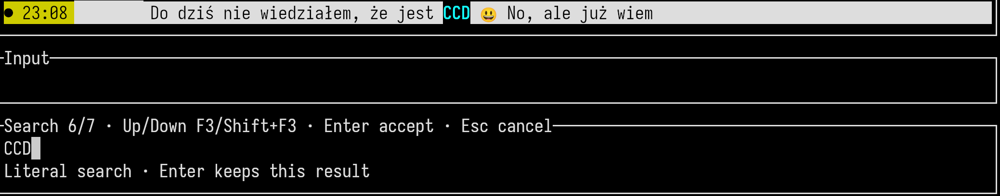

*Literal search for CCD, showing result 6 of 7. Up/Down changes the result; Enter keeps its position.*

### Editing sent messages

Select your own message with PgUp/PgDown, then press **e** or **Ctrl+E** with an
empty composer. Enter submits the edit; Esc cancels. In multiline mode, Enter
adds a newline: switch back with Alt+Enter before submitting. With a draft, `e`
remains a normal letter. Other people's or deleted messages cannot be edited.

Gurk enforces up to 10 edits within 24 hours, checking at edit start and send.
Note to Self has no age limit but retains the edit count limit. Counts include
locally known synchronized edits; missing history cannot be counted. Expired
editing drafts remain available to copy. Stored revisions do not appear as
separate conversation messages. Recipients can inspect edit history; see
[Signal's editing rules](https://support.signal.org/hc/en-us/articles/6255134251546-Edit-Message).

### Contact mentions

Type **@Barto** to find contacts such as **Bartosz Kowalski**, matching names or
local aliases without case sensitivity. Current group members are listed first;
hidden people are excluded. No network lookup or typing notification is sent.
Use Up/Down to choose, **Tab or Enter to insert**, and Esc to dismiss. Acceptance
does not send the draft. Duplicate labels show an account ID for disambiguation.

Confirmed mentions are cyan/bold and carry the person's Signal account identity;
recipients resolve their own contact name rather than receiving your local alias.
They survive saved drafts, edits and attachment captions. Editing characters
inside a confirmed name makes it plain text; pasted/typed `@name` is not bound
automatically. Ambiguous compound external-editor changes may also remove the
binding. Mention notifications depend on recipients, membership and settings.

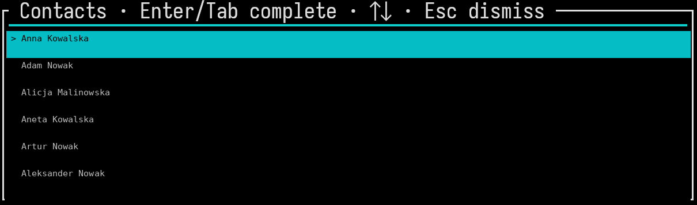

*Contact completion for @a. Tab or Enter inserts the selected mention.*

### ASCII emoticons

Enable `auto_ascii_emoticons = true` to replace standalone ASCII faces after
whitespace/newline and before sending, including pasted text and captions.
It is disabled by default and does not rewrite received or forwarded messages.
Confirmed mention labels, URLs, paths and glued forms such as `abc:)` stay literal.
Existing `:shortcode:` completion works independently.

| Forms | Emoji | Forms | Emoji |
| --- | --- | --- | --- |
| `:)` `:-)` | 🙂 | `;)` `;-)` | 😉 |
| `:D` `:-D` | 😃 | `:P` `:p` `:-P` `:-p` | 😛 |
| `:(` `:-(` | 🙁 | `:/` `:-/` | 😕 |
| `:\|` `:-\|` | 😐 | `:O` `:o` `:-O` `:-o` | 😮 |
| `:'(` `:'-(` | 😢 | `<3` | ❤️ |

Disabling the setting stops future conversion; emoji already inserted in drafts
remain emoji.

### Offline spelling

Spelling is enabled by default for Polish and US English. Install dictionary
files, for example on Arch:

```sh
sudo pacman -S hunspell-pl hunspell-en_us
```

The Rust background worker checks after a 300 ms pause; it does not use the
Hunspell executable or a remote service. Words accepted by either dictionary are
accepted. Suspect words are red/underlined. **F9** opens suggestions at the cursor,
or for the first suspect word. Up/Down selects, Enter replaces, `i` ignores for
this session and Esc closes. Enter in this dialog never sends.

There is no automatic correction or mandatory pre-send check. Links, paths,
emails, numeric tokens and backtick-delimited code are skipped. This is spelling,
not grammar; checks cover the first 32 KiB of a draft. Suggestions load on demand.
Missing dictionaries are reported in the Input title. Configure persistent
exceptions and dictionary locations in `[spellcheck]`; restart after changes.

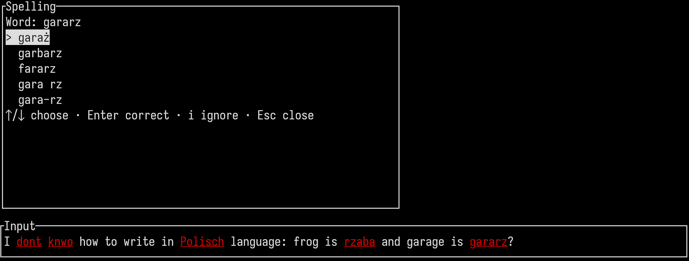

*Local Polish spelling suggestions: gararz can be replaced with garaż. The draft shows underlined suspect words.*

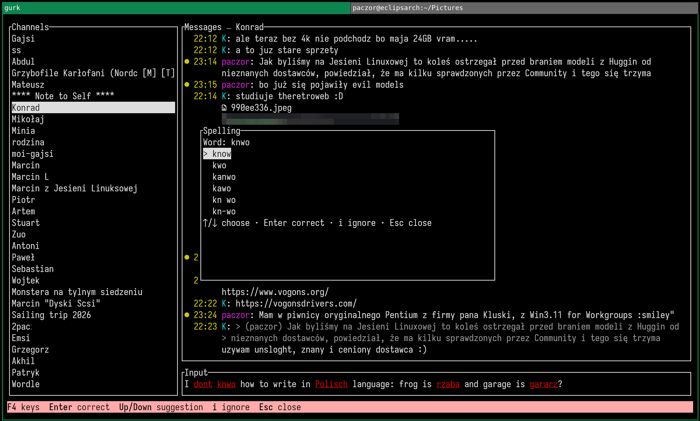

*Local English spelling suggestions: knwo can be replaced with know. Enter applies a suggestion without sending the message.*

### Image metadata cleaning

`clean_image_metadata = true` cleans outgoing **JPEG and PNG detected by content**,
including picker uploads, screenshots, clipboard images and forwarded files.
HEIC and other unsupported formats are sent unchanged. Set the option to false
to send originals.

Cleaning copies compressed image data without recompressing pixels. It removes
descriptive EXIF/XMP/IPTC/MakerNotes, comments, thumbnails and PNG C2PA blocks.
Appended Motion Photo video and extra JPEG images, including HDR gain maps, are
removed; the main image remains SDR. ICC profiles, rendering information and
minimal EXIF Orientation are retained, as are PNG transparency and supported
APNG animation chunks.

Original files are unchanged; only outgoing bytes and the local sent copy are
cleaned. Malformed recognized images stop the upload and preserve the composer.
Filenames, visible content and retained rendering fields can still identify a
source: this is targeted metadata cleanup, not forensic anonymization.

### Forwarding

Select a message and press **Alt+R**. Choose another visible conversation;
**Enter sends**, Esc cancels. The source conversation and hidden conversations
are excluded. The original conversation's draft and selection remain intact.

The new message carries content and fresh attachment uploads, without an added
source-attribution header, source quote, reactions or edit state. Explicit
mentions retain their identities. Names written in the body, filenames and image
contents are not anonymized. All attachments must be downloaded successfully;
missing/pending/failed files prevent partial forwarding. Size limits and outgoing
metadata cleaning apply.

### Private read synchronization

Gurk synchronizes displayed incoming messages with its own linked devices through
encrypted self-directed `SyncMessage.read` messages. It does not send contact-facing
read/delivery receipts or typing indicators. Only messages in the displayed
viewport are queued; help, dialogs and image previews do not mark the underlying
conversation read.

A durable queue retries when online. Previously read history is synchronized
when displayed again; confirmed entries are not resent on every redraw. Other
clients must receive and process their pending sync messages, so unread status
may not update immediately. FocusLost pauses marking in supporting terminals;
without focus reporting, gurk assumes the terminal is active. This cannot prove
a person actually looked at a message, and other clients control their own
activity behavior.

## Keyboard shortcuts

F1 is the in-app reference. **F4** toggles the shortcut menu. The main menu stays
at the bottom; selecting a message adds its contextual actions above it, and
clearing selection hides that upper section. Function keys appear first in
numeric order (F1, F2, …), using your configured bindings. Each section uses
aligned columns and wraps independently in narrow terminals. Dialogs and the
gallery show their own controls instead. Initial visibility and
contrast/dark/custom colors are configured under `[shortcut_bar]`.

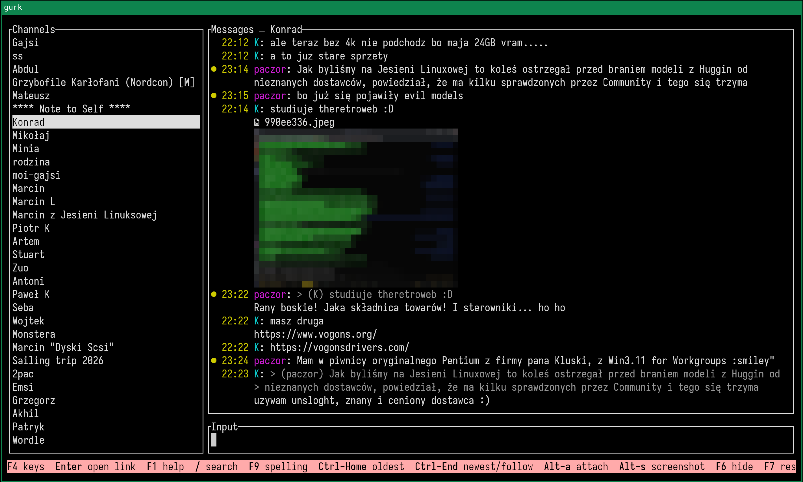

*F4 toggles the contextual shortcut bar. The bar shows the conversation controls.*

### Conversation and composer

| Key | Action |
| --- | --- |
| F1 / F4 | Help / contextual shortcut bar |
| Ctrl+C / Ctrl+L | Quit / redraw |
| Up, Ctrl+K / Down, Ctrl+J | Previous / next conversation |
| Ctrl+P / Alt+L | Conversation picker / toggle conversation pane |
| PgUp, Alt+Up, Alt+K / PgDown, Alt+Down, Alt+J | Previous / next message; past newest clears reply selection |
| Ctrl+Home / Ctrl+End | Oldest / newest message and follow |
| F2 / F3 | Conversation alias / person alias |
| F5 | Toggle active conversation as a favorite |
| F6 / F7 / Alt+M | Hide / restore list / toggle channel mute |
| Alt+A / Alt+S / Alt+P | Attach files / screenshot / attachment gallery |
| / with empty draft, F8 | Search current conversation |
| Alt+V / Alt+Y | Select text / copy selected message |
| e or Ctrl+E, selected message and empty draft | Edit own sent message |
| Ctrl+D / Alt+R, selected message | Delete own message / forward message |
| Ctrl+T / Ctrl+H, selected message | React with thumbs-up / heart |
| F9 / Ctrl+O | Spelling dialog / edit draft in `$EDITOR` |
| Alt+Enter | Toggle multiline input |
| Left/Right, Ctrl+Left/Right | Move one character |
| Alt+Left/Right, Alt+B/F | Move one word |
| Home, Ctrl+A / End, Ctrl+E | Start / end of input line; Ctrl+E is contextual as above |
| Ctrl+W, Alt+Backspace / Ctrl+U | Delete previous word / delete to line start |
| Tab | Complete emoji shortcode; otherwise react with a valid input emoji |
| Enter | Send; in multiline input insert newline; with empty single-line input open selected URL/file |
| Esc | Dismiss notice/modal, cancel edit/staged files or clear reply selection, depending on context |

Bindings in `message_selected`, such as Ctrl+D, Ctrl+T/H and Alt+Y, apply with
an empty composer. In multiline input, Up/Ctrl+K and Down/Ctrl+J move between input lines. In help,
Up/PgUp/Ctrl+K and Down/PgDown/Ctrl+J scroll. In the conversation picker,
Up/Ctrl+K and Down/Ctrl+J select an entry. Ctrl+Backspace has no default binding.

### Modal controls

| Context | Main controls |
| --- | --- |
| File picker | Space marks; Enter enters/stages; Left/Right navigates; Alt+P previews; Alt+O opens by MIME |
| Gallery | Left/Right attachment; +/- zoom; Alt+arrows pan; Esc/q returns |
| Search | Up/Down or Shift+F3/F3 result; Enter accepts; Esc restores position |
| Text selection | Arrows move; Space selects; Enter copies; Esc cancels |
| Contact completion | Up/Down or Shift+Tab selects; Tab/Enter inserts; Esc dismisses |
| Spelling | Up/Down suggestion; Enter corrects; i ignores; Esc closes |
| Forwarding | Up/Down or Home/End target; Enter sends; Esc cancels |

## Configuration

### Files and paths

Use `gurk --config PATH` (`-c`) or `GURK_CONFIG` for an explicit configuration.
Otherwise gurk checks `$XDG_CONFIG_HOME/gurk/gurk.toml` and
`$XDG_CONFIG_HOME/gurk.toml` when set, then the platform configuration directory's
`gurk/gurk.toml` and `gurk.toml`, then `$HOME/.gurk.toml`.
On Linux the usual path is `~/.config/gurk/gurk.toml`.

Data directory precedence is `--data-dir`/`GURK_DATA_DIR`, the `data_dir` setting,
then `$XDG_DATA_HOME/gurk` or the platform data directory. It holds history,
registration and attachments. `gurk --help` lists startup options;
[src/config.rs](src/config.rs) is the full configuration reference.

### Defaults

| Setting | Default |
| --- | --- |
| `show_image_previews` | `false` |
| `show_attachment_paths` | `false` (filename labels) |
| `auto_ascii_emoticons` | `false` |
| `clean_image_metadata` | `true` (JPEG/PNG) |
| `nerd_font_icons` | `true`; use a Nerd Font, or set false for text labels |
| `message_order` | `"sent"` |
| `[image_viewer] mode / protocol` | `"internal"` / `"auto"` |
| `[shortcut_bar] enabled / theme` | `false` / `"contrast"` |
| `[spellcheck] enabled / languages` | `true` / `["pl_PL", "en_US"]` |

Restart after changing configuration. Keep existing generated settings when
adding options. **Top-level options must precede table headers** such as `[user]`.
This example opts into previews, receipt order, the shortcut bar and ASCII faces:

```toml
show_image_previews = true
show_attachment_paths = false
auto_ascii_emoticons = true
clean_image_metadata = true
nerd_font_icons = false
message_order = "received"
# screenshot_dir = "~/Pictures/gurk"
# screenshot_command = ["maim", "-s"]

[user]
display_name = "Example user"

[image_viewer]
mode = "internal"
protocol = "auto"
# Other protocols: "halfblocks", "kitty", "sixel".
# For an external GUI viewer, use instead:
# mode = "external"
# command = ["sxiv", "-a"]

[shortcut_bar]
enabled = true
theme = "contrast" # Or "dark".
# Optional #RRGGBB overrides:
# background = "#D3D3D3"
# foreground = "#000000"

[spellcheck]
enabled = true
languages = ["pl_PL", "en_US"]
dictionary_dirs = []
ignored_words = ["gurk"]
```

Dictionary lookup checks configured directories, then
`$XDG_DATA_HOME/gurk/dictionaries`, `/usr/share/hunspell`,
`/usr/share/myspell/dicts` and `/usr/share/myspell`. Keep matching `.aff` and `.dic`
files together; supported legacy encodings are decoded locally.

### Rebinding actions

Use `[keybindings.MODE]`, with mode `anywhere`, `normal`, `message_selected`,
`channel_modal`, `multiline` or `help`. Keys use names such as `left`, `alt-j`,
`ctrl-f` and `pagedown`. An empty command removes that binding;
`default_keybindings = false` at the top level disables the default set.
Dialog navigation keys are generally fixed; the actions opening dialogs can be rebound.

```toml
[keybindings.anywhere]
ctrl-c = ""
ctrl-q = "quit"

[keybindings.normal]
alt-p = ""
alt-i = "view_image"
F8 = "search_messages"

[keybindings.message_selected]
e = "edit_message"
```

Commands include `attach_files`, `capture_screenshot`, `view_image`,
`search_messages`, `jump_oldest`, `jump_newest`, `select_text`, `forward_message`,
`check_spelling`, `edit_channel_alias`, `edit_person_alias`, `hide_channel`,
`show_hidden_channels`, `toggle_favorite` and `toggle_shortcut_bar`. Existing navigation/editing
commands remain available; see [src/command.rs](src/command.rs) for the complete
command grammar and default mode bindings.

### MIME associations

Alt+O in the picker uses the desktop's MIME defaults, independently of
`[image_viewer]`. On Linux it needs `xdg-utils` and a graphical desktop session.
Choose a graphical application so it does not compete for gurk's terminal.
For example, using desktop IDs installed on your system:

```sh
xdg-mime query filetype "$HOME/Pictures/example.png"
xdg-mime query default image/png
xdg-mime default sxiv.desktop image/png image/jpeg
xdg-mime default org.pwmt.zathura.desktop application/pdf
```

Desktop IDs are `.desktop` filenames in `/usr/share/applications` or
`~/.local/share/applications`. A custom entry can use `Exec=sxiv %f`,
`Terminal=false` and the relevant `MimeType=` values. These associations are
desktop-wide, not gurk-specific; see `man xdg-mime` and `man xdg-open`.

## Secure Backup restore

The experimental startup importer restores an **existing cloud Signal Secure
Backup** and available attachments. Link gurk to the same account first and keep
the phone's backup enabled. This uses the **64-character recovery key**, not the
old Android local `.backup` file and its 30-digit passphrase. Close other gurk
instances using the database before importing.

```sh
gurk --restore-cloud-backup --backup-dry-run
gurk --restore-cloud-backup
```

The database passphrase and hidden recovery-key prompt are separate. Keep the key
out of command-line arguments. `--backup-key-file /private/path/key` can instead
read a regular private file; on Unix, remove group/other permissions (`chmod 600`).
Whitespace, hyphens, capitalization and the phone's displayed `#`/`=` substitutions
are normalized.

### Validation and resume

Dry run downloads, authenticates and inventories the archive without merging
local history. It still writes encrypted staging, contacts Signal and may perform
bounded SVR-B recovery. Failed recovery is not automatically retried because the
server limits attempts. A successful recovery token is reused for the same
archive from encrypted staging. Import does not reserve, upload or delete backups,
register/relink the phone, or send activity/read receipts.

The work directory is `data_dir/backup-import`; `--backup-work-dir PATH` overrides
it. Reuse it when resuming. Downloads support HTTP range/ETag checks; restored
media is authenticated and hash-checked. Allow space for encrypted downloads,
staging and restored files. Imports stream files and page messages instead of
loading the entire archive into RAM.

Import is **additive**, not a single replacement transaction. If it ends
incomplete, validated records may already be visible. Rerun to continue;
existing IDs are deduplicated. `--backup-messages-only` imports available text
without media, deferring file-only records; a later full run hydrates missing
attachments. Aliases, hidden conversations, drafts, existing edits, deletion
markers, receipts and registration are preserved. Expired disappearing messages
are omitted. With `message_order = "received"`, backup order becomes a history
prefix and existing local messages absent from the backup follow afterward.

### Reports and limitations

Gurk converts supported text, files/images, quotes, reactions, timers and
receipts. Unsupported records, such as polls, some service updates, non-ACI
contacts and full revision history, are counted and retained in encrypted
staging; raw retention does not make them visible in gurk.

```sh
gurk --backup-report
gurk --backup-report --backup-work-dir /private/path
```

The report is offline and read-only. It asks for the database passphrase, not the
recovery key, and does not load Signal registration or contact Signal. It shows
fixed categories/counts rather than message text, filenames, identifiers, URLs or
keys. Archive timestamp-collision counts describe the archive, not unresolved
conflicts with already stored history. Different senders sharing a timestamp are
preserved under separate local keys while keeping their Signal timestamps.

`transit_http_404` means the temporary CDN reference is unavailable. If it lacks
a plaintext hash, the importer cannot derive an archive-media lookup ID from it.
Retrying the same missing object does not repair it; another copy may still exist
elsewhere. Keep staging while investigating failures/deferred messages.
After verification you may remove import staging, but retain
`data_dir/files/backup`, which contains attachments used by imported messages.
Automated archive/media tests do not replace testing restoration of a live account.

## Troubleshooting and limits

- **Unreadable icons:** use a Nerd Font or set `nerd_font_icons = false`.
- **Images in multiplexers:** graphics protocols need terminal/multiplexer support
  or passthrough. Try `protocol = "halfblocks"`; half blocks still need a working
  Unicode font and suitable color support. Gurk does not change Screen/tmux setup.
- **PageUp/PageDown on compact keyboards:** terminal key mapping takes precedence.
  Use F1 to check gurk actions; the terminal must actually emit PageUp/PageDown.
- **Selection versus reply:** a selected message is a reply target. Esc or PgDown
  past the newest message clears it. An error notice consumes the first Esc.
- **Attachment failures:** keep gurk running until upload/submission completes or
  an error appears. Missing download/preparation data is not silently forwarded.
- **Clipboard access:** copying needs a functioning desktop clipboard backend.

For attachment diagnostics:

```sh
RUST_LOG=gurk=info,libsignal_service=warn,presage=warn gurk --verbose
```

`gurk.log` includes batch start/result/completion and submission events, correlated
by `message_timestamp`. Successful submission is not a delivery receipt. Upload
records exclude message bodies, attachment bytes, keys and CDN URLs; other log
records can contain filenames. Broader tracing can include sensitive details.

## Credits, license and contact

### Original project

**boxdot and the gurk contributors** created the original project. Its
[repository](https://github.com/boxdot/gurk-rs),
[contributors](https://github.com/boxdot/gurk-rs/graphs/contributors),
[releases](https://github.com/boxdot/gurk-rs/releases) and
[upstream interface screenshot](screenshot.png) retain their attribution.
The [Cargo author metadata](Cargo.toml) and upstream Git ancestry are preserved.

Gurk builds on [Presage](https://github.com/whisperfish/presage),
[libsignal-service](https://github.com/whisperfish/libsignal-service-rs) and
[Signal's libraries](https://github.com/signalapp/libsignal). Vendored source
revisions, changes and licenses are listed in [vendor/README.md](vendor/README.md).
The Codex/bitounu statement above records the extension development process.

### License

Gurk and this modified version use **GNU AGPL version 3 only**:
[AGPL-3.0-only](LICENSE-AGPL-3.0), also published by
[GNU](https://www.gnu.org/licenses/agpl-3.0.html). Original and third-party
copyright/license notices remain applicable; the provenance statement does not
replace them or establish ownership of upstream code.

When distributing modified source/binaries, preserve required notices and meet
the applicable Corresponding Source obligations. Dependency notices also need to
be included where required. The current packaging recipes do not assemble a full
third-party notice bundle. See the [bounded license review](docs/LICENSE_REVIEW.md)
for the findings, network-use conditions and remaining binary-release checks.

### Contributions

Unless explicitly stated otherwise, contributions intentionally submitted for
inclusion in this project are licensed under AGPL-3.0-only, without additional
terms or conditions.

### Contact

Report extension-specific issues in the issue tracker of the repository you
cloned. For problems reproduced in original gurk, use the
[upstream issue tracker](https://github.com/boxdot/gurk-rs/issues).
The [original Signal community group][chat-link] is an upstream contact channel;
its [QR code](chat-qr.png) and [support link for boxdot](https://ko-fi.com/boxdot)
belong to that project.

[chat-link]: https://signal.group/#CjQKILaqQTWUZks14mPRSn0m0zyU9A-buNMG6haQBmWrxJHeEhCc7HLIwCFZRNDw63MWj-fA
